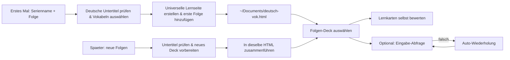

[🇨🇳 中文](README.md) · [🇺🇸 English](README.en.md) · **🇩🇪 Deutsch**

<div align="center">

# 德剧词 · DeutschVok

### Lerne authentisches Deutsch aus deutschen Serien.

Autor: 疯狂的豇豆 · [www.crazyowen.cn](https://www.crazyowen.cn)

Gib Name und Folge einer deutschen Serie oder eines Films an, und DeutschVok fügt den Wortschatz dieser Folge deiner universellen HTML-Lernseite hinzu.

[Demo herunterladen](https://github.com/owenwuhaha/deutsch-vok/raw/refs/heads/main/examples/demo.html) · [In Codex installieren](#in-codex-installieren) · [Nutzung](#nutzung)


</div>

**DeutschVok** wählt nützliche Ausdrücke aus den echten deutschen Untertiteln einer angegebenen deutschen Serie und fügt sie derselben universellen HTML-Lernseite hinzu. Nach dem ersten Erstellen und der ersten Folge werden spätere Folgen in dieselbe Datei zusammengeführt; öffne die Seite, um zwischen den Decks zu wechseln und zu üben. Standardmäßig wird mit Lernkarten selbst bewertet; du kannst auch auf „Eingabe-Abfrage" (Deutsch aus einer chinesischen Vorgabe eintippen) mit automatischer Bewertung und Wiederholung umschalten.

> Die Demo-Seite verwendet 8 originale deutsche Sätze, um die Funktionen zu demonstrieren; sie stammt aus keiner Serie.

## Deutschspezifische Fähigkeiten

- **Substantive mit Artikel**: Jedes Substantiv zeigt `der/die/das` und die Pluralform (z. B. `der Bogen → die Bögen`).
- **Trennbare Verben**: Wenn im Satz getrennt (z. B. `aufgeben` → `gib … auf`), werden Lücke und Bewertung in der tatsächlichen Wortform verwendet.
- **Grammatiknotizen**: Feste Redewendungen, Kasus (Akkusativ/Dativ/Genitiv), Zeiten, Idiome usw. kommen in das Feld `grammar` der Karte.
- **Deutsche Vorlesefunktion**: Die Seite liest den Originalsatz mit der deutschen Gerätestimme (`de-DE`) vor.

## Lernablauf



Jede Vokabelkarte enthält das deutsche Wort (mit Artikel), IPA, kontextuelle Bedeutung, Originalsatz und Übersetzung. Standardmäßig wird mit Lernkarten selbst bewertet; die Eingabe-Abfrage blendet den Zielausdruck im Originalsatz aus, prüft die Eingabe und plant falsche Wörter zur Wiederholung ein. Akzeptierte Schreib- oder Ausdrucksvarianten werden vom Deck explizit aufgeführt. Jedes Folgen-Deck speichert seinen Lernfortschritt unabhängig.

Das Deutsch-Niveau bestimmt den Vokabelbereich: Standard CEFR B1–B2; gibt der Nutzer Prüfung und Niveau an, wird dieser Bereich priorisiert, z. B. Goethe-Zertifikat A1–C2, TestDaF, telc Deutsch, ÖSD, DSH. Nach der Erzeugung fragt der Agent, ob der Wortschatz zu schwer, passend oder zu leicht war, und kann den Bereich anhand des Feedbacks nach oben oder unten anpassen.

## Installation

Klone dieses Repo in das Skills-Verzeichnis deiner Plattform. Pfade und Aktivierung je Plattform:

### In Codex installieren

Unter macOS / Linux:

```bash
git clone --depth 1 https://github.com/owenwuhaha/deutsch-vok.git ~/.codex/skills/deutsch-vok
```

### In WorkBuddy installieren

Benutzerebene (für alle Projekte):

```bash
git clone --depth 1 https://github.com/owenwuhaha/deutsch-vok.git ~/.workbuddy/skills/deutsch-vok
```

Projektebene (nur aktueller Workspace, in das `.workbuddy/skills/`-Verzeichnis des Projekts):

```bash
git clone --depth 1 https://github.com/owenwuhaha/deutsch-vok.git <dein-projekt>/.workbuddy/skills/deutsch-vok
```

Nach dem Klonen WorkBuddy neu starten oder `$deutsch-vok` direkt im Chat aufrufen.

### In Doubao (豆包) installieren

- **Doubao Web/Client (Workbench)**: Öffne „自定义技能 / 技能管理" (Eigene Skills) → Skill erstellen → füge den gesamten Inhalt von `SKILL.md` in das Skill-Inhaltsfeld ein → Name „德剧词 / DeutschVok" und Auslösewörter setzen (z. B. „德剧词", „德语词汇") → speichern und aktivieren.
- **Doubao TUI (CLI)**: in das globale Skills-Verzeichnis legen und Client neu starten:

```bash
git clone --depth 1 https://github.com/owenwuhaha/deutsch-vok.git ~/.doubao/skills/deutsch-vok
# oder ~/.agents/skills/deutsch-vok
```

### In Hermes Agent installieren

Auf [hermes.crazyowen.cn](https://hermes.crazyowen.cn) einen Agent registrieren oder erstellen (den Community-Verifizierungsablauf abschließen) und den gesamten `SKILL.md`-Inhalt in dessen „Persona / Anweisungen" einfügen; Name „德剧词 / DeutschVok", Beschreibung aus dem `description`-Feld von SKILL.md. Nach dem Speichern kann der Agent deutsche Serien-Vokabeln extrahieren.

### In OpenClaw installieren

In das gemeinsame Skills-Verzeichnis legen (gilt für alle Agents auf diesem Rechner), dann Gateway neu starten:

```bash
git clone --depth 1 https://github.com/owenwuhaha/deutsch-vok.git ~/.openclaw/skills/deutsch-vok
openclaw gateway restart   # oder neue Sitzung: /new
openclaw skills list       # Laden verifizieren
```

Aufruf: `/deutsch-vok` im Chat eingeben oder den Wunsch in natürlicher Sprache beschreiben.

---

Falls bereits installiert, wechsle in das Skill-Verzeichnis und führe `git pull` aus, um zu aktualisieren. Nach der Installation verwende es in einer neuen Aufgabe so:

```text
Nutze $deutsch-vok, um eine HTML-Vokabel-Lernseite für Dark S01E01 zu erstellen.
```

Du kannst dem Agenten auch direkt deutsche Untertitel oder Drehbuchtext geben. Bei anderen Agents, die Skills unterstützen, lege das gesamte Repo in dessen persönliches Skills-Verzeichnis.

## Nutzung

Standardmäßig bis zu 50 deutsche Wörter pro Folge; reicht das Untertitelmaterial nicht aus, wird entsprechend dem tatsächlichen Inhalt erzeugt, ohne aufzufüllen. Vorhandene Untertitel werden direkt verwendet; sobald eine verlässliche Quelle vorliegt, beginnt die Aufbereitung, ohne den Ablauf zum Sammeln mehrerer Quellen zu verlängern.

```text
Erstelle mit DeutschVok das Deck Dark S01E01 und füge es meiner Lernseite hinzu.
```

Bei der ersten Nutzung wird die Lernseite unter `~/Documents/deutsch-vok.html` gespeichert und enthält das Deck der ersten Folge. Wenn du später eine neue Folge nennst, führt der Agent das neue Deck automatisch in dieselbe Datei zusammen, liefert das aktualisierte HTML und nennt die hinzugefügte Folge; du musst kein JSON manuell importieren. Ist die Datei bereits im Browser geöffnet, öffne die aktualisierte Datei erneut, um das neue Deck zu sehen. Findet oder liest der Agent die vorhandene Lernseite nicht, fragt er nach dem Original-Dateipfad oder der Datei und erstellt keine neue leere Bibliothek, die das Original überschreibt.

Doppelklicke auf `deutsch-vok.html`, um zu lernen. Die Seite hängt nicht von Anki, einem Server oder dem Netzwerk ab; kein Python nötig. Die Seite bewertet standardmäßig mit Lernkarten; du kannst in der Seite auf „Eingabe-Abfrage" umschalten; diese Wahl wird im aktuellen Browser gespeichert und gilt für alle Decks. Die HTML-Datei enthält die gesamte Vokabelbibliothek; kopiere sie, um die Bibliothek zu sichern; Lernfortschritt und Modus-Einstellung werden im Browser gespeichert und müssen über die Fortschrittssicherung der Seite separat exportiert werden. Beim Wechsel von Browser, Gerät oder Verschieben der Datei folgen die lokalen Daten nicht automatisch; die vollständige Migration erfordert die HTML-Datei und die Fortschrittssicherung. Ob die Gerätestimme verfügbar ist, hängt vom Browser ab.

Achte nach jeder Erzeugung auf die Schwierigkeits-Rückfrage des Agents. Antworte „zu schwer" oder „zu leicht" und nenne die Prüfung und das Niveau; der Agent aktualisiert dasselbe Folgen-Deck; kein manueller JSON-Import nötig.

## Anwendungsbereich

- Für das Vokabellernen aus einzelnen deutschen Film-/Serienfolgen oder Podcast-Abschnitten (deutsche Serien, deutsche Filme, deutsche Nachrichten, deutsche Podcasts).
- Untertitelquelle und -inhalt müssen zur angegebenen Folge/Sendung verifizierbar sein; findet sich keine verlässliche deutsche Untertitel, fragt der Agent dich nach Untertiteln und erfindet keine Sätze aus dem Gedächtnis.
- Es werden nur ausgewählte Beispielsätze gespeichert; die kompletten Episodenuntertitel werden nicht in die Seite gepackt.
- Die Seite unterstützt die Auswahl mehrerer Folgen-Decks und die Wiederholung falscher Wörter; derzeit gibt es keine tageübergreifende FSRS-/Anki-artige Wiederholungsplanung.
- „Diese Runde richtig" bedeutet, dass die Eingabe diesmal korrekt war, nicht dass sie dauerhaft gemerkt ist.

## Manuelles Erzeugen

Für die Validierung des Vokabulars und das Zusammenführen in die universelle Lernseite wird die Standardbibliothek von Python 3 benötigt; Lernende brauchen nur einen Browser.

```bash
python3 scripts/build_html.py examples/demo.json study.html
```

Datenformat des Vokabulars: siehe [references/data-format.md](references/data-format.md). Die Seite nutzt `vocab-library`, um die gesamte Bibliothek einzubetten; das gelieferte HTML benötigt kein begleitendes JSON oder andere Dateien. Betreuer können beim manuellen Erzeugen der Demo-Seite weiterhin ein HTML aus dem JSON einer Einzelfolge erstellen.

## Projektstruktur

| Pfad | Zweck |
|---|---|
| `SKILL.md` | Auslösebedingungen und Erzeugungsablauf des Agents (Deutsch-only) |
| `assets/study.html` | Vorlage der universellen Lernseite (deutsche Artikel/Plural-Anzeige, de-DE-Vorlesen) |
| `scripts/build_html.py` | Validiert Einträge und erzeugt die Lernseite |
| `references/` | Deutsche Untertitelquellen und Eintragsformat-Doku |
| `examples/demo.html` | Direkt öffnenbare original deutsche Demo |

## Wartungs-Verifikation

Bei Änderungen an Vorlage oder Generator kannst du ausführen:

```bash
python3 -m unittest discover -s tests -p 'test_*.py'
npm install && npm test
```

Die Browser-Interaktionstests verwenden lokales Chrome und Playwright. Vokabel-Erzeugungs-/Zusammenführungstests und Chrome-Offline-Interaktionstests wurden ausgeführt und decken Standard-Selbstrating, Eingabemodus-Umschaltung, deckübergreifende Einstellungen, Fortschrittsisolation pro Folge, HTML-Zusammenführungsupdates, Migration alter Decks sowie Sprach-/Prüfungsmetadaten ab. Die Gerätestimme wurde nicht hörbar verifiziert.

## Quelle & Lizenz

Dieses Projekt ist adaptiert von [pyang5166/gbro-series-vocab](https://github.com/pyang5166/gbro-series-vocab) und ändert die Anki/Markdown-Auslieferung in eine eigenständige HTML-Lernseite, wobei die LernSprache auf Deutsch festgelegt ist (neue Artikel/Plural/Grammatiknotizen und de-DE-Vorlesen). Autor: 疯狂的豇豆 ([www.crazyowen.cn](https://www.crazyowen.cn)), unter Beibehaltung der upstream MIT-Lizenz und des Copyright-Hinweis des ursprünglichen Autors pyang5166 (狗哥笔记). TypeWords' Übungsdesign dient nur als Referenz; dieses Repo kopiert keinen GPL-3.0-Quellcode.
