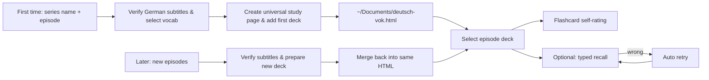

[🇨🇳 中文](README.md) · **🇺🇸 English** · [🇩🇪 Deutsch](README.de.md)

<div align="center">

# 德剧词 · DeutschVok

### Learn authentic German from German TV series.

Author: 疯狂的豇豆 · [www.crazyowen.cn](https://www.crazyowen.cn)

Give the name and episode number of a German series or film, and DeutschVok adds that episode's German vocabulary to your universal HTML study page.

[Download demo](https://github.com/owenwuhaha/deutsch-vok/raw/refs/heads/main/examples/demo.html) · [Install to Codex](#install-to-codex) · [Usage](#usage)


</div>

**DeutschVok** picks useful expressions from the real German subtitles of a specified German series and adds them to the same universal HTML study page. After the first creation and the first episode, later episodes are merged into the same file; open the page to switch decks and practice. Flashcard self-rating is the default; you can also switch to typed recall (type German from a Chinese prompt) with automatic grading and retry.

> The demo page uses 8 original German sentences to demonstrate the features; it does not come from any series.

## German-only features

- **Nouns carry gender**: each noun shows `der/die/das` and its plural form (e.g. `der Bogen → die Bögen`).
- **Separable verb marking**: when split in the sentence (e.g. `aufgeben` → `gib … auf`), cloze and grading use the actual word form.
- **Grammar notes**: fixed phrases, cases (Akkusativ/Dativ/Genitiv), tenses, idioms, etc. go into the card's `grammar` field.
- **German TTS**: the page reads the original sentence with the device's German voice (`de-DE`).

## Learning flow



Each vocabulary card includes the German word (with gender), IPA, contextual meaning, original sentence and translation. Flashcard self-rating is the default; typed recall hides the target expression in the original sentence, checks the input and schedules wrong words for retry. Acceptable spelling or expression variants are explicitly listed by the deck. Each episode deck stores its practice progress independently.

The German level determines the vocabulary range: default CEFR B1–B2; if the user states an exam and level, filtering prioritizes that exam's range, e.g. Goethe-Zertifikat A1–C2, TestDaF, telc Deutsch, ÖSD, DSH. After generation the Agent asks whether the vocabulary felt too hard, right, or too easy, and can shift the range down or up based on feedback.

## Install to Codex

On macOS / Linux:

```bash
git clone --depth 1 https://github.com/owenwuhaha/deutsch-vok.git ~/.codex/skills/deutsch-vok
```

If already installed, enter the skill directory and run `git pull` to update. After installing, use it in a new task like:

```text
Use $deutsch-vok to generate an HTML vocabulary study page for Dark S01E01.
```

You can also give the Agent German subtitles or script text directly. For other Agents that support Skills, just place the whole repo into its personal Skills directory.

## Usage

By default up to 50 German words per episode; if subtitle material is insufficient, generate based on actual content without padding. Existing subtitles are used directly; once a reliable source is obtained, organization starts without extending the flow to collect multiple sources.

```text
Use DeutschVok to generate the Dark S01E01 deck and add it to my study page.
```

On first use, the study page is saved at `~/Documents/deutsch-vok.html` and contains the first episode deck. When you later request a new episode, the Agent automatically merges the new deck back into the same file, delivers the updated HTML and states which episode was added; you don't need to import JSON manually. If the file is already open in the browser, reopen the updated file to see the new deck. If the Agent cannot find or read the existing study page, it will ask you for the original file path or file, and will not create a new empty library that overwrites the original.

Double-click `deutsch-vok.html` to study. The page does not depend on Anki, a server, or the network; no Python install needed. The page defaults to flashcard self-rating; you can switch to "typed recall" in the page; this choice is saved in the current browser and applies to all decks. The HTML file contains the whole vocabulary library; copy it to back up the library; practice progress and mode preference are stored in the browser and need to be exported separately via the page's progress backup feature. When switching browsers, devices, or moving the file, local data is not guaranteed to follow automatically; full migration requires the HTML and the progress backup. Whether device voice is available depends on the browser.

After each generation, watch for the Agent's difficulty follow-up. Reply "too hard" or "too easy", and tell it which exam and level you are taking; the Agent will update the same episode deck; no manual JSON import needed.

## Scope

- For vocabulary learning from single German film/TV episodes or podcast segments (German series, German films, German news, German podcasts).
- Subtitle source and content must be verifiable to the specified episode/program; when reliable German subtitles cannot be found, the Agent asks you for subtitles and will not invent lines from memory.
- Only save selected study example sentences; do not package whole-episode subtitles into the page.
- The page supports multiple episode deck selection and wrong-word retry; it does not yet provide cross-day FSRS / Anki-style review scheduling.
- "Correct this round" means the input was correct this time, not that it is long-term memorized.

## Manual generation

Python 3 standard library is needed to validate the vocabulary and merge it into the universal study page; learners only need a browser.

```bash
python3 scripts/build_html.py examples/demo.json study.html
```

Vocabulary data format: see [references/data-format.md](references/data-format.md). The page uses `vocab-library` to embed the whole library collection; the delivered HTML needs no JSON or other files accompanying it. Maintainers can still create an HTML from a single-episode JSON when manually generating the demo page.

## Project structure

| Path | Purpose |
|---|---|
| `SKILL.md` | Agent trigger conditions and generation flow (German-only) |
| `assets/study.html` | Universal study page template (German gender/plural display, de-DE reading) |
| `scripts/build_html.py` | Validates entries and generates the study page |
| `references/` | German subtitle sources and entry format docs |
| `examples/demo.html` | Directly openable original German demo |

## Maintainer verification

When the template or generator changes, you can run:

```bash
python3 -m unittest discover -s tests -p 'test_*.py'
npm install && npm test
```

Browser interaction tests use local Chrome and Playwright. Vocabulary generation/merge tests and Chrome offline interaction tests have been run, covering default self-rating, input mode switching, cross-deck preferences, per-episode progress isolation, HTML merge updates, old deck migration, and language/exam metadata. Device voice has not been verified by ear.

## Source & license

This project is adapted from [pyang5166/gbro-series-vocab](https://github.com/pyang5166/gbro-series-vocab), changing Anki/Markdown delivery to a standalone HTML study page and locking the learning language to German (adding gender/plural/grammar notes and de-DE reading). Author: 疯狂的豇豆 ([www.crazyowen.cn](https://www.crazyowen.cn)), retaining the upstream MIT license and the original author pyang5166 (狗哥笔记)'s copyright notice. TypeWords' exercise design is for reference only; this repo does not copy its GPL-3.0 source code.
