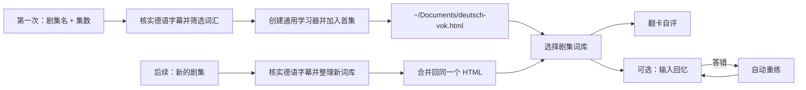

<details align="center">
<summary>English</summary>

**DeutschVok** turns German TV episodes, films and podcast transcripts into vocabulary decks inside one reusable HTML study page. The first use creates the page and adds the first deck; later episodes are merged into the same file. Flashcard self-rating is the default, with optional typed recall and automatic retry. No Anki, server, or runtime dependency is required. German-only: nouns carry der/die/das and plural forms, separable verbs and case notes are marked.
</details>

<div align="center">

# 德剧词 · DeutschVok

### 看德剧，学地道德语。

作者：疯狂的豇豆 · [www.crazyowen.cn](https://www.crazyowen.cn)

给出德语剧集/电影名和集数，把这一集的德语词库加入你的通用 HTML 学习器。

[下载体验页](https://github.com/owenwuhaha/deutsch-vok/raw/refs/heads/main/examples/demo.html) · [安装到 Codex](#安装到-codex) · [使用方法](#使用)


</div>

**德剧词**从指定德语剧集的真实德语字幕中挑选实用表达，加入同一个通用 HTML 学习器。第一次创建学习器并加入首集后，后续每集会合并到这个文件；打开页面即可切换词库练习。默认用翻卡自评，也可以切换到根据中文提示输入德语、自动判题和重练。

> 示例页使用 8 个原创德语句子演示功能，不来自任何剧集。

## 德语专属能力

- **名词带词性**：每条名词显示 `der/die/das` 与复数形式（如 `der Bogen → die Bögen`）。
- **可分动词标注**：在原句中拆开时（如 `aufgeben` → `gib … auf`），按实际词形挖空与判题。
- **语法备注**：固定搭配、格（Akkusativ/Dativ/Genitiv）、时态、成语等写到卡片 `grammar` 字段。
- **德语朗读**：页面用设备德语语音（`de-DE`）朗读原句。

## 学习流程



每条词汇卡包括德语词（含词性）、音标、语境释义、原句和译文。翻卡自评是默认方式；输入回忆会隐藏原句中的目标表达，检查输入并安排错词重练。可接受的拼写或表达变体由词库明确列出。每个剧集词库独立保存练习进度。

德语分级决定词汇范围：默认 CEFR B1–B2；如果用户说明考试和级别，会优先按对应考试范围筛选，例如 Goethe-Zertifikat A1–C2、TestDaF、telc Deutsch、ÖSD、DSH。生成后 Agent 会询问词汇是偏难、合适还是偏简单，并可按反馈把范围下调或上调。

## 安装到 Codex

macOS / Linux 上执行：

```bash
git clone --depth 1 https://github.com/owenwuhaha/deutsch-vok.git ~/.codex/skills/deutsch-vok
```

如果已安装，进入技能目录执行 `git pull` 更新。安装后在新任务里这样使用：

```text
使用 $deutsch-vok，为我生成 Dark S01E01 的 HTML 词汇学习页。
```

也可以直接把德语字幕或剧本文字提供给 Agent。其他支持 Skills 的 Agent，将整个仓库放入它的个人 Skills 目录即可。

## 使用

默认每集整理最多 50 条德语词汇，字幕材料不足时按实际内容生成，不凑数量。已有字幕会直接使用；拿到一份可靠来源后就开始整理，不会为了收集多份来源而延长流程。

```text
用德剧词生成《Dark》S01E01 词库，加入我的学习器。
```

首次使用时，学习器保存在 `~/Documents/deutsch-vok.html` 并包含首集词库。以后提出新剧集，Agent 会把新词库自动合并回同一个文件，交付更新后的 HTML 并说明已加入哪一集；你不需要手动导入 JSON。如果这个文件已经在浏览器打开，重新打开更新后的文件即可看到新词库。若 Agent 找不到已有学习器或无法读取它，会向你索要原文件路径或文件，不会另建一个空库覆盖原有内容。

双击 `deutsch-vok.html` 即可学习。网页不依赖 Anki、服务器或网络；无需安装 Python。页面默认使用翻卡自评，可在页面中切换“输入回忆”；这个选择会保存在当前浏览器并应用于所有词库。HTML 文件包含整套词库，复制它即可备份词库；练习进度和模式偏好保存在浏览器，需要用页面的进度备份功能另行导出。换浏览器、设备或移动文件时，本地数据不保证自动跟随，完整迁移需要带上 HTML 和进度备份。设备语音是否可用取决于浏览器。

每次生成后请留意 Agent 的难度回访。回复“太难”或“太简单”，并告诉它你要考的考试和级别，Agent 会更新同一剧集词库；不需要手动导入 JSON。

## 适用范围

- 面向德语影视单集/播客段落词汇学习（德剧、德语电影、德语新闻、德语播客）。
- 字幕来源和内容必须能核实到指定剧集/节目；找不到可靠德语字幕时，Agent 会请你提供字幕，不会凭记忆造台词。
- 只保存精选学习例句，不把整集字幕打包进网页。
- 网页支持多剧集词库选择与错词重练；目前不提供跨天的 FSRS / Anki 式复习排程。
- “本轮答对”表示这次输入正确，不代表已经长期记住。

## 手动生成

需要 Python 3 的标准库来校验词库并合并到通用学习器；学习者只需浏览器。

```bash
python3 scripts/build_html.py examples/demo.json study.html
```

词库数据格式见 [references/data-format.md](references/data-format.md)。页面使用 `vocab-library` 内嵌整个词库集合；交付的 HTML 不需要 JSON 或其他文件伴随。维护者手动生成演示页时仍可从单集 JSON 创建 HTML。

## 项目结构

| 路径 | 用途 |
|---|---|
| `SKILL.md` | Agent 的触发条件与生成流程（德语专用） |
| `assets/study.html` | 通用学习器模板（含德语词性/复数显示、de-DE 朗读） |
| `scripts/build_html.py` | 校验词条并生成学习页 |
| `references/` | 德语字幕来源与词条格式说明 |
| `examples/demo.html` | 可直接打开的原创德语示例 |

## 维护者验证

模板或生成器改动时，可以运行：

```bash
python3 -m unittest discover -s tests -p 'test_*.py'
npm install && npm test
```

浏览器交互测试使用本机 Chrome 和 Playwright。已运行词库生成/合并测试和 Chrome 离线交互测试，覆盖默认自评、输入模式切换、跨词库偏好、每集进度隔离、HTML 合并更新、旧单词库迁移和语言/考试元数据。设备语音没有做听感验证。

## 来源与许可

本项目由 [pyang5166/gbro-series-vocab](https://github.com/pyang5166/gbro-series-vocab) 改编，将 Anki/Markdown 交付改为独立 HTML 学习页，并把学习语言锁定为德语（新增词性/复数/语法备注与 de-DE 朗读）。作者：疯狂的豇豆（[www.crazyowen.cn](https://www.crazyowen.cn)），保留上游 MIT 许可与原作者 pyang5166（狗哥笔记）的版权声明。TypeWords 的练习设计仅作参考，本仓库没有复制其 GPL-3.0 源代码。
